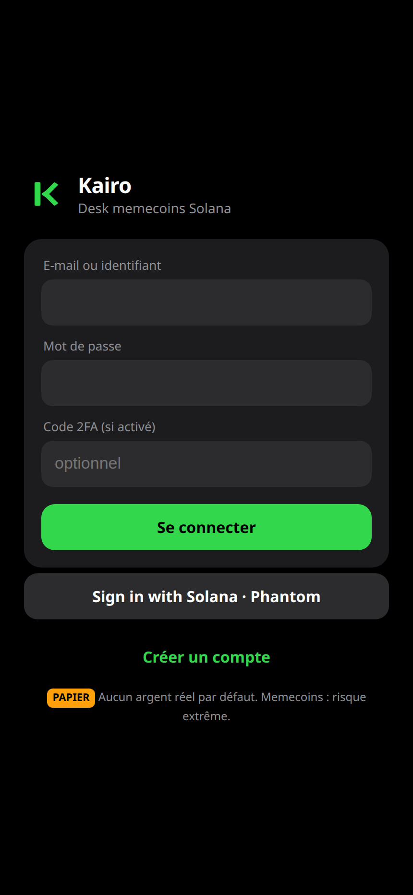
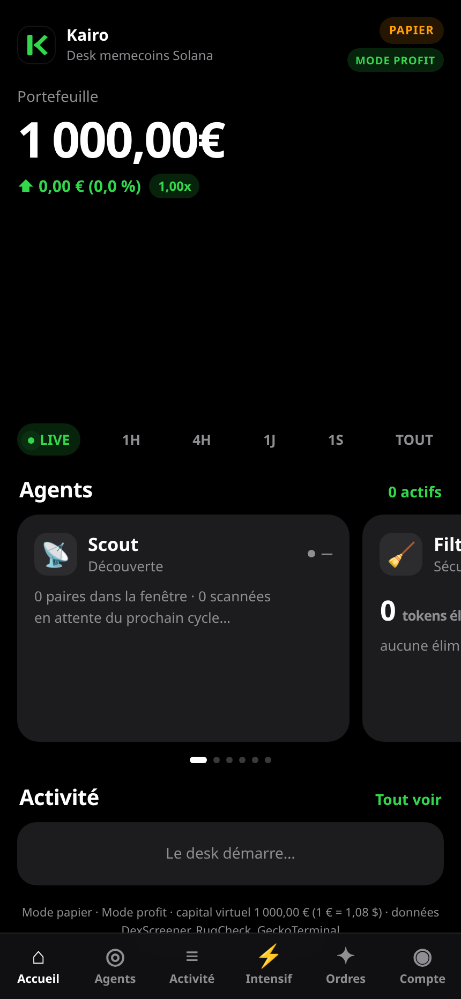
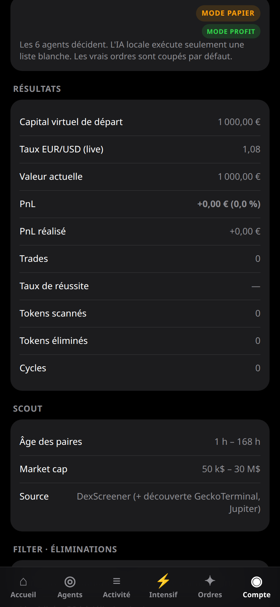

# Kairo

Kairo : desk de trading memecoins Solana piloté par 6 agents IA, 24 h/24. Paper trading avec un capital au choix et une remise à zéro, IA locale gratuite, connexion Phantom et Kraken (vrais ordres désactivés par défaut), login Google, Apple ou email. Fonctionne sur Mac, Windows, Linux et en web app sur iPhone. Open source.

Interface sombre, mobile d'abord, en français. Un bouton **EN** traduit les libellés principaux.


| Connexion | Desk |
|---|---|
|  |  |

Le compte affiche le capital papier, les règles du mode en cours, et les réglages (capital, remise à zéro, Phantom, Kraken, trading réel coupé, 2FA).



## Télécharger

Rien à compiler. Le paquet embarque Python. Il ne reste qu'à brancher une IA locale (Ollama, LM Studio ou llama.cpp) si vous en voulez une. Sans modèle, le desk papier tourne quand même.

| | |
|---|---|
| macOS Apple Silicon | [Kairo-macos-arm64.dmg](https://github.com/businesstradeforex-ui/kairo/releases/latest) |
| macOS Intel | [Kairo-macos-intel.dmg](https://github.com/businesstradeforex-ui/kairo/releases/latest) |
| Windows x64 | [Kairo-windows-x64.zip](https://github.com/businesstradeforex-ui/kairo/releases/latest) |
| Linux x64 | [tar.gz](https://github.com/businesstradeforex-ui/kairo/releases/latest) · [deb](https://github.com/businesstradeforex-ui/kairo/releases/latest) · [AppImage](https://github.com/businesstradeforex-ui/kairo/releases/latest) |
| Linux arm64 | [tar.gz](https://github.com/businesstradeforex-ui/kairo/releases/latest) · [deb](https://github.com/businesstradeforex-ui/kairo/releases/latest) · [AppImage](https://github.com/businesstradeforex-ui/kairo/releases/latest) |
| Docker | `ghcr.io/businesstradeforex-ui/kairo:1.0.0` (amd64 et arm64) |

Les liens ouvrent la dernière release. Le fichier exact s'appelle `Kairo-<version>-<plateforme>.*`.

Sur Mac, **Kairo.app** (1.2.0) ouvre sa propre fenêtre, une icône dans le Dock et une icône dans la barre des menus. Ce n'est plus un onglet de navigateur. L'app n'est pas signée par Apple : Réglages Système → Confidentialité et sécurité → Ouvrir quand même, ou `xattr -dr com.apple.quarantine /Applications/Kairo.app`.

Une ligne, macOS ou Linux (bash) :

```bash
curl -fsSL https://raw.githubusercontent.com/businesstradeforex-ui/kairo/main/install.sh | bash
```

Windows (PowerShell) :

```powershell
irm https://raw.githubusercontent.com/businesstradeforex-ui/kairo/main/install.ps1 | iex
```

macOS, app non signée : la première fois, clic droit sur Kairo puis **Ouvrir** (Gatekeeper). Détail dans [docs/install/macos.md](docs/install/macos.md).

Au premier lancement, l'application crée son dossier de données et sa clé de chiffrement, ouvre le navigateur, et cherche Ollama, LM Studio ou llama.cpp. Sinon elle affiche http://127.0.0.1:8787/setup . Le trading réel reste éteint.

Image Docker : [docs/install/docker.md](docs/install/docker.md). Notes : [1.2.0](docs/release-notes/v1.2.0.md).

Si Python est déjà là : `pipx install "kairo @ git+https://github.com/businesstradeforex-ui/kairo.git"` puis `kairo`. Chaque release joint aussi `kairo.rb` (cask Homebrew, arm et Intel), `kairo.json` (Scoop) et un manifeste winget. Ils ne sont pas poussés dans un tap ni soumis à winget-pkgs : les empreintes ne sont connues qu'une fois les fichiers construits. Le chemin supporté, lui, est `install.sh` / `install.ps1`.

## Avertissement

Logiciel **expérimental**. Les memecoins sont extrêmement risqués : vous pouvez tout perdre. Kairo démarre en **paper trading**. Aucun ordre réel n'est envoyé tant que le serveur (`KAIRO_LIVE_ENABLED`) et le compte ne l'ont pas demandé explicitement, ordre par ordre. Ce n'est pas un conseil en investissement.

Les décisions de trading viennent du code des agents, pas du modèle de langue. Le desk reproduit les règles et les paramètres d'origine. L'IA locale est l'exécuteur des ordres autorisés et un assistant. Détail : [docs/moteur.md](docs/moteur.md).

## Les six agents

Scout → Filter → Analyst → Executor → Risk → Logger.

| Mode | Idée |
|---|---|
| strict | Règles d'origine, seuil 70, fail-closed |
| agressif | Plus de candidats, signaux rapides, seuil 45 |
| profit | Défaut. Moins de trades, filtres de la session d'origine |
| intensif | Sous-portefeuille à part, flux publics, scalping papier |

Chaque compte a son portefeuille, son capital de départ et sa remise à zéro (confirmation `RESET`).

## Démarrer

```bash
./install.sh
# puis http://127.0.0.1:8787
```

Le premier compte est le **propriétaire**. E-mail et mot de passe marchent sans configuration. Google, Apple et le lien magique restent cachés tant que leurs variables ne sont pas définies (voir `.env.example`). Sign in with Solana (Phantom) est disponible : l'extension ou le navigateur Phantom signe un message, jamais une transaction, et aucune clé privée n'est demandée.

| Plateforme | Guide |
|---|---|
| macOS | [docs/install/macos.md](docs/install/macos.md) |
| Windows (natif, WSL, Docker) | [docs/install/windows.md](docs/install/windows.md) |
| Linux | [docs/install/linux.md](docs/install/linux.md) |
| Docker | [docs/install/docker.md](docs/install/docker.md) |
| Oracle Always Free | [docs/install/oracle.md](docs/install/oracle.md) |
| Site public et PWA iPhone | [docs/exposition.md](docs/exposition.md) |
| IA locale, de A à Z | [docs/ia-locale.md](docs/ia-locale.md) |
| Classement des modèles | [docs/modeles.md](docs/modeles.md) |

Sans install :

```bash
python3 -m venv .venv && .venv/bin/pip install -r requirements.txt
export MEMEDESK_DATA="$HOME/kairo-data" KAIRO_FX=1.08
mkdir -p "$MEMEDESK_DATA"
.venv/bin/python kairo/manage.py create-user you --role owner
.venv/bin/python kairo/run.py all
```

## Comptes connectés

Dans **Compte** : Phantom ou Solflare (adresse publique), Kraken, Binance, Coinbase (clé et secret chiffrés, de préférence **sans droit de retrait**), Jupiter (cotations publiques, sans clé). Le système de connecteurs est une table : on en ajoute un en l'enregistrant dans `connectors.CONNECTORS`.

Le trading réel est **off**. L'activer demande `KAIRO_LIVE_ENABLED=1`, puis `confirm=LIVE` sur le compte, puis pour chaque ordre un jeton et le mot `CONFIRMER`. Plafonds par ordre et par jour, kill switch.

## Propriétaire et assistant

Seul le rôle `owner` voit `/admin`. Un jeton à scopes (lecture, paramètres, ordres de la liste blanche, mise à jour de l'interface) se crée, se révoque et se tourne. Journal d'audit. `KAIRO_ADMIN_ALLOWLIST` limite les IP du jeton. Personne d'autre n'ouvre cette API.

## Développement

```bash
pip install -r requirements.txt -r requirements-dev.txt
python -m unittest discover -s tests -v
ruff check kairo tests
```

MIT. Journal des versions : [CHANGELOG.md](CHANGELOG.md). Sécurité : [SECURITY.md](SECURITY.md).

Les notes du desk d'origine (pondérations, hypothèses, rapport) sont dans [docs/historique/](docs/historique/).
